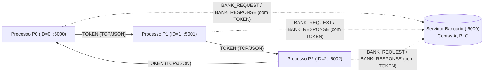
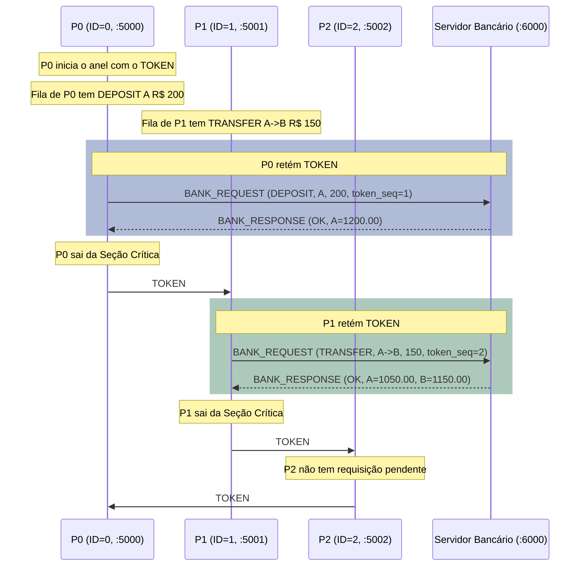

# Trabalho Prático — Sistemas Distribuídos (Grupo 2)

## Algoritmo de Exclusão Mútua Distribuído baseado em Anel aplicado a um Sistema Bancário

**Universidade Federal de Santa Catarina (UFSC) — Campus Araranguá**  
**Disciplina:** Sistemas Distribuídos  
**Tema:** Grupo 2 — Algoritmo de Exclusão Mútua distribuído baseado em Anel  
**Integrantes:** Pedro Magnavita e Lucas Schemes 
**Linguagem:** Python 3 (Biblioteca Padrão)

---

## 1. Descrição da Proposta

Em sistemas distribuídos, múltiplos processos independentes podem precisar acessar e modificar um mesmo recurso compartilhado de forma concorrente. Sem um mecanismo de coordenação, acessos simultâneos produzem **condições de corrida** (*race conditions*) e atualizações perdidas (*lost updates*), corrompendo o estado do sistema.

Este trabalho implementa o **Algoritmo de Exclusão Mútua Distribuído baseado em Anel** (baseado na especificação clássica de Coulouris et al. e Tanenbaum & Van Steen) aplicado a um **Sistema Bancário de Contas e Transferências**. A arquitetura é composta por dois serviços principais que se comunicam via **sockets TCP** utilizando mensagens estruturadas em **JSON**:

1. **Serviço 1 — Servidor Bancário (`bank_server.py`):** Representa o **recurso compartilhado (Seção Crítica)**, armazenando contas bancárias (`A`, `B` e `C`) e executando operações de consulta de saldo, depósito, saque e transferência. O servidor não aplica travas globais durante o processamento simulado das operações, mas monitora ativamente a concorrência na Seção Crítica para comprovar que a exclusão mútua é garantida exclusivamente pelo anel distribuído.
2. **Serviço 2 — Nó do Anel / Cliente Bancário (`ring_node.py`):** Cada instância representa um processo $P_i$ numerado ($P_0, P_1, P_2$) conectado em um **anel lógico** unidirecional ($P_0 \rightarrow P_1 \rightarrow P_2 \rightarrow P_0$). Uma única mensagem especial denominada **`TOKEN`** circula continuamente pelo anel. Somente o processo que detém o `TOKEN` possui permissão para entrar na Seção Crítica e enviar requisições de movimentação financeira ao Servidor Bancário.

---

## 2. Requisitos Funcionais (Cliente e Servidor)

### 2.1 Identificação dos Processos e Serviços

Cada entidade do sistema possui um identificador numérico único, nome simbólico e endereço de rede (`host:porta`), definidos de forma centralizada em `config.json`:

| Serviço / Processo | ID Numérico | Nome | Endereço TCP Padrão | Papel no Sistema |
| :--- | :---: | :---: | :---: | :--- |
| Servidor Bancário | — | `BANCO` | `127.0.0.1:6000` | Servidor do recurso compartilhado (Seção Crítica) |
| Processo 0 | `0` | `P0` | `127.0.0.1:5000` | Nó do anel (sucessor: `P1`) e cliente do banco |
| Processo 1 | `1` | `P1` | `127.0.0.1:5001` | Nó do anel (sucessor: `P2`) e cliente do banco |
| Processo 2 | `2` | `P2` | `127.0.0.1:5002` | Nó do anel (sucessor: `P0`) e cliente do banco |

### 2.2 Requisitos Funcionais do Servidor Bancário (`bank_server.py`)

- **RF-S1 (Gerenciamento de Contas):** Manter em memória o saldo das contas bancárias configuradas (`A`, `B`, `C`, iniciando com `R$ 1000,00` cada).
- **RF-S2 (Operações Bancárias):** Receber mensagens do tipo `BANK_REQUEST` via TCP e responder com `BANK_RESPONSE`, suportando as operações:
  - `BALANCE`: consulta o saldo de uma conta específica ou de todas (`ALL`);
  - `DEPOSIT`: credita um valor positivo em uma conta;
  - `WITHDRAW`: debita um valor positivo de uma conta, validando saldo suficiente;
  - `TRANSFER`: transfere um valor positivo de uma conta de origem para uma conta de destino distinta, validando saldo suficiente;
  - `HISTORY` / `STATS`: retorna o histórico recente de transações e as métricas de auditoria de exclusão mútua.
- **RF-S3 (Auditoria de Exclusão Mútua):** Contabilizar o número de processos simultaneamente ativos dentro da Seção Crítica (`active_in_cs`), registrando a concorrência máxima (`max_concurrent_cs`) e alertando caso ocorra qualquer violação (`violations > 0`).
- **RF-S4 (Atendimento Concorrente):** Aceitar múltiplas conexões TCP em threads separadas, com atraso simulado de processamento (`processing_delay`) entre leitura e escrita do saldo, de modo que qualquer falha na coordenação distribuída seria imediatamente exposta.

### 2.3 Requisitos Funcionais do Nó do Anel / Cliente (`ring_node.py`)

- **RF-C1 (Participação no Anel Lógico):** Identificar seu próprio `id`, abrir um servidor TCP local na porta correspondente para receber o `TOKEN` de seu antecessor e calcular automaticamente seu sucessor $P_{(i + 1) \bmod N}$.
- **RF-C2 (Enfileiramento de Requisições):** Permitir que o usuário (via interface interativa no terminal) ou um script de teste enfileire requisições bancárias a qualquer momento, sem bloquear a circulação do `TOKEN`.
- **RF-C3 (Controle de Exclusão Mútua):**
  - Ao receber o `TOKEN`, se houver requisição pendente na fila local, o processo **retém o `TOKEN`**, atua como **cliente TCP** do Servidor Bancário enviando a requisição `BANK_REQUEST`, aguarda a `BANK_RESPONSE` e só então libera o `TOKEN` ao sucessor.
  - Se não houver requisição pendente, o processo apenas repassa o `TOKEN` ao sucessor após o intervalo configurado (`token_pass_delay`).
  - Atender **no máximo 1 requisição por passagem do `TOKEN`**, prevenindo *starvation* (inanição) dos demais processos.
- **RF-C4 (Tolerância na Inicialização):** Caso o processo sucessor ainda não tenha sido iniciado, tentar reenviar o `TOKEN` periodicamente (`retry_interval`) até que o anel esteja completo.

### 2.4 Formato das Mensagens (Protocolo TCP + JSON)

Todas as mensagens trafegam sobre conexões **TCP** codificadas em **UTF-8** no formato **JSON delimitado por quebra de linha (`\n`)**, evitando problemas de fragmentação de fluxo (*stream framing*):

- **Passagem de Token entre nós do anel (`TOKEN`):**
```json
{
  "type": "TOKEN",
  "token_id": "RING-TOKEN-1",
  "seq": 5,
  "sender_id": 0,
  "sender_name": "P0",
  "timestamp": "17:49:54.429"
}
```

- **Requisição do Cliente ao Servidor Bancário (`BANK_REQUEST`):**
```json
{
  "type": "BANK_REQUEST",
  "process_id": 0,
  "process_name": "P0",
  "token_seq": 4,
  "operation": "TRANSFER",
  "account": "A",
  "target_account": "B",
  "amount": 150.0
}
```

- **Resposta do Servidor Bancário ao Cliente (`BANK_RESPONSE`):**
```json
{
  "type": "BANK_RESPONSE",
  "status": "OK",
  "operation": "TRANSFER",
  "accounts": { "A": 1350.0, "B": 1050.0, "C": 700.0 },
  "message": "Transferencia de R$ 150.00 de A para B concluida (A: R$ 1350.00 | B: R$ 1050.00)."
}
```

---

## 3. Arquitetura e Comunicação

### 3.1 Topologia do Sistema

Cada nó do anel exerce papel híbrido: é **servidor TCP** para receber o `TOKEN` do antecessor, **cliente TCP** do sucessor para repassar o `TOKEN`, e **cliente TCP** do **Servidor Bancário** exclusivamente enquanto está na posse do `TOKEN`.



### 3.2 Diagrama de Sequência da Comunicação

O diagrama abaixo ilustra um ciclo completo onde `P0` e `P1` possuem operações bancárias pendentes, enquanto `P2` apenas repassa o token:



---

## 4. Descrição do Serviço e Execução do Algoritmo

### 4.1 Execução no Servidor Bancário (`bank_server.py`)

O servidor escuta em `127.0.0.1:6000`. Para cada conexão TCP aceita, uma thread dedicada executa `_handle_client`, lê o JSON da requisição e chama `_process_request`. Antes de executar uma operação (`BALANCE`, `DEPOSIT`, `WITHDRAW` ou `TRANSFER`), o servidor incrementa `active_in_cs`:

- Se `active_in_cs > 1`, uma **violação de exclusão mútua** é contabilizada e registrada no log.
- Em seguida, `_execute_bank_operation` lê o saldo atual, aguarda `processing_delay` segundos (simulando latência de leitura/escrita em banco de dados) e grava o novo saldo.
- Ao concluir, decrementa `active_in_cs` no bloco `finally`, registra a transação no histórico e devolve `BANK_RESPONSE` ao cliente.

### 4.2 Execução do Algoritmo Baseado em Anel (`ring_node.py`)

Cada processo $P_i$ executa duas threads em segundo plano além do terminal interativo:

1. **Thread Receptora (`_listen_ring`):** Escuta na porta do processo (`5000 + id`), recebe mensagens `TOKEN` do antecessor, fecha a conexão TCP imediatamente (evitando bloqueios ou *deadlocks* em anéis pequenos) e coloca o token na fila interna `_token_queue`.
2. **Thread Trabalhadora do Token (`_token_worker`):** Retira o `TOKEN` da fila interna e verifica `pending_requests`:
   - **Com requisição pendente:** chama `_enter_critical_section`, envia `BANK_REQUEST` ao Servidor Bancário, aguarda `BANK_RESPONSE` e libera a Seção Crítica.
   - **Sem requisição pendente:** aguarda `token_pass_delay` (para legibilidade dos logs) e não acessa o servidor.
   - Por fim, incrementa o número de sequência (`seq + 1`), atualiza `sender_id` para o seu próprio ID e invoca `_forward_token` para enviar o `TOKEN` ao sucessor $P_{(i + 1) \bmod N}$.

**Propriedades atendidas pelo algoritmo:**
- **Segurança (*Safety*):** Como existe apenas um `TOKEN` circulando no anel, no máximo um processo acessa o Servidor Bancário por vez (`max_concurrent_cs == 1`).
- **Vivacidade (*Liveness*) e Justiça (*Fairness*):** Como cada processo executa no máximo uma operação por visita do token e sempre o repassa em sentido único, todo processo que deseja entrar na Seção Crítica consegue acesso em no máximo $N - 1$ execuções de outros processos, sem *starvation*.

---

## 5. Blocos de Código Principais

### 5.1 Definição dos Números dos Processos e Topologia do Anel

Em `config.json`, são definidos os números (`id`), nomes e portas de cada processo, bem como os parâmetros do Servidor Bancário:

```json
{
  "bank_server": {
    "host": "127.0.0.1",
    "port": 6000,
    "processing_delay": 0.4,
    "initial_accounts": { "A": 1000.0, "B": 1000.0, "C": 1000.0 }
  },
  "ring": {
    "token_pass_delay": 0.8,
    "retry_interval": 1.0,
    "processes": [
      { "id": 0, "name": "P0", "host": "127.0.0.1", "port": 5000 },
      { "id": 1, "name": "P1", "host": "127.0.0.1", "port": 5001 },
      { "id": 2, "name": "P2", "host": "127.0.0.1", "port": 5002 }
    ]
  }
}
```

Em `protocol.py`, a função `get_successor` determina o próximo nó no anel lógico usando aritmética modular `(idx + 1) % len(processes)`:

```python
def get_successor(config: dict[str, Any], process_id: int) -> dict[str, Any]:
    """Retorna o processo sucessor no anel logico: P_{(indice + 1) mod N}."""
    processes = config["ring"]["processes"]
    for idx, proc in enumerate(processes):
        if proc["id"] == process_id:
            return processes[(idx + 1) % len(processes)]
    raise ValueError(f"Processo id={process_id} nao encontrado na configuracao do anel.")
```

### 5.2 Forma de Comunicação: Envio e Recepção de Mensagens (TCP + JSON)

Em `protocol.py`, toda comunicação entre nós do anel e entre cliente e servidor utiliza sockets TCP (`AF_INET`, `SOCK_STREAM`) com framing delimitado por `\n`:

```python
def send_json(conn: socket.socket, message: dict[str, Any]) -> None:
    """Serializa um dicionario em JSON UTF-8 finalizado com '\\n' e envia via socket TCP."""
    payload = (json.dumps(message, ensure_ascii=False) + "\n").encode("utf-8")
    conn.sendall(payload)


def receive_json(conn: socket.socket) -> dict[str, Any] | None:
    """Recebe uma mensagem JSON delimitada por quebra de linha ('\\n') de um socket TCP."""
    with conn.makefile("r", encoding="utf-8") as reader:
        line = reader.readline()
    if not line:
        return None
    return json.loads(line)


def send_message(
    host: str,
    port: int,
    message: dict[str, Any],
    expect_reply: bool = False,
    timeout: float = 5.0,
) -> dict[str, Any] | None:
    """Abre conexao TCP, envia a mensagem JSON e opcionalmente aguarda resposta."""
    with socket.socket(socket.AF_INET, socket.SOCK_STREAM) as sock:
        sock.settimeout(timeout)
        sock.connect((host, port))
        send_json(sock, message)
        if expect_reply:
            return receive_json(sock)
    return None
```

### 5.3 Recepção do Token, Entrada na Seção Crítica e Repasse no Anel

Em `ring_node.py`, o processo recebe o `TOKEN` via socket TCP em `_listen_ring`, decide pela entrada na Seção Crítica em `_token_worker`, comunica-se com o Servidor Bancário em `_enter_critical_section` e repassa o `TOKEN` ao sucessor em `_forward_token`:

```python
def _listen_ring(self) -> None:
    """Recebe mensagens TCP vindas do antecessor no anel."""
    with socket.socket(socket.AF_INET, socket.SOCK_STREAM) as server_sock:
        server_sock.setsockopt(socket.SOL_SOCKET, socket.SO_REUSEADDR, 1)
        server_sock.bind((self.host, self.port))
        server_sock.listen(8)
        server_sock.settimeout(0.5)
        while not self._stop_event.is_set():
            try:
                conn, _addr = server_sock.accept()
            except socket.timeout:
                continue
            with conn:
                message = receive_json(conn)
            if message and message.get("type") == MSG_TOKEN:
                self._token_queue.put(message)
```

```python
def _enter_critical_section(self, pending: PendingRequest, token_seq: int, sender_name: str) -> None:
    """Executa a operacao bancaria no servidor enquanto retem o TOKEN."""
    request_payload = dict(pending.payload)
    request_payload["token_seq"] = token_seq
    response = send_message(
        host=self.bank_cfg["host"],
        port=self.bank_cfg["port"],
        message=request_payload,
        expect_reply=True,
        timeout=10.0,
    )
    pending.response = response
    pending.done_event.set()
```

```python
def _forward_token(self, token_msg: dict[str, Any]) -> None:
    """Envia o TOKEN via TCP ao processo sucessor, tentando novamente caso ele ainda esteja iniciando."""
    while not self._stop_event.is_set():
        try:
            send_message(
                host=self.successor["host"],
                port=self.successor["port"],
                message=token_msg,
                expect_reply=False,
                timeout=3.0,
            )
            return
        except OSError:
            self._stop_event.wait(self.retry_interval)
```

### 5.4 Execução do Serviço e Monitoramento no Servidor Bancário

Em `bank_server.py`, o servidor contabiliza a entrada e saída da Seção Crítica e executa a operação bancária solicitada (como a transferência entre contas):

```python
with self._metrics_lock:
    self.active_in_cs += 1
    self.total_requests += 1
    if self.active_in_cs > self.max_concurrent_cs:
        self.max_concurrent_cs = self.active_in_cs
    if self.active_in_cs > 1:
        self.violations += 1
        self._log("[ALERTA] VIOLACAO DE EXCLUSAO MUTUA!")

try:
    result = self._execute_bank_operation(request, process_id, process_name, token_seq)
    return result
finally:
    with self._metrics_lock:
        self.active_in_cs -= 1
```

---

## 6. Instalação, Configuração e Execução

### 6.1 Pré-requisitos e Bibliotecas

- **Python 3.10 ou superior** (testado em Python 3.12.2).
- **Nenhuma biblioteca externa é necessária (`pip install` não é requerido).** O projeto utiliza exclusivamente módulos da biblioteca padrão do Python: `socket`, `threading`, `json`, `queue`, `argparse`, `dataclasses`, `pathlib`, `time`, `datetime`, `copy` e `unittest`.

### 6.2 Clonagem e Configuração

```bash
git clone https://github.com/pedromagnavita/Trabalho-Pratico-Sistemas-Distribuidos-Grupo2.git
cd Trabalho-Pratico-Sistemas-Distribuidos-Grupo2
```

Caso deseje adicionar mais nós ao anel ou alterar portas/saldos iniciais, edite o arquivo [`config.json`](config.json).

---

### 6.3 Modo 1 — Execução Distribuída em Terminais Separados (Interativo)

Abra **4 terminais** na pasta do projeto e execute um comando em cada terminal:

**Terminal 1 — Iniciar o Servidor Bancário (Seção Crítica):**
```bash
python bank_server.py
```

**Terminal 2 — Iniciar o Processo P0 (gera o `TOKEN` inicial):**
```bash
python ring_node.py --id 0 --initial-token
```

**Terminal 3 — Iniciar o Processo P1:**
```bash
python ring_node.py --id 1
```

**Terminal 4 — Iniciar o Processo P2:**
```bash
python ring_node.py --id 2
```

> **Dica:** Para reduzir o volume de logs quando o token circula sem requisições pendentes, adicione a flag `--quiet-token` (ex.: `python ring_node.py --id 1 --quiet-token`).

Em qualquer terminal de processo (`P0`, `P1` ou `P2`), digite os comandos abaixo para enfileirar transações bancárias:

| Comando | Exemplo | Descrição |
| :--- | :--- | :--- |
| `saldo [conta]` | `saldo A` ou `saldo` | Consulta saldo de uma conta ou de todas |
| `depositar <conta> <valor>` | `depositar A 250` | Enfileira depósito na conta informada |
| `sacar <conta> <valor>` | `sacar B 100` | Enfileira saque na conta informada |
| `transferir <orig> <dest> <valor>` | `transferir A B 150` | Enfileira transferência entre contas |
| `historico` | `historico` | Exibe histórico de transações e auditoria de exclusão mútua |
| `status` | `status` | Mostra ID, sucessor, posse do token e fila pendente do nó |
| `sair` | `sair` | Encerra o processo |

---

### 6.4 Modo 2 — Demonstração Automatizada Ponta-a-Ponta

Para subir o Servidor Bancário e os 3 nós do anel automaticamente, disparar 6 operações concorrentes simultâneas (depósitos, saques, transferências e consulta) e validar a consistência matemática dos saldos:

```bash
python run_demo.py
```

**Exemplo real de saída obtida:**
```text
--- Disparando operacoes bancarias simultaneas em P0, P1 e P2 ---

[17:49:54.162] [P0] [SECAO CRITICA] TOKEN #4 recebido de P2 -> RETIDO! Executando DEPOSIT R$ 200.00 (conta A) no Servidor Bancario...
[17:49:54.429] [BANCO] Secao Critica FINALIZADA por P0 -> Deposito de R$ 200.00 na conta A concluido (novo saldo: R$ 1200.00).
[17:49:54.429] [P0] [SECAO CRITICA] Saindo da secao critica e liberando TOKEN #5 para P1.
[17:49:54.445] [P1] [SECAO CRITICA] TOKEN #5 recebido de P0 -> RETIDO! Executando WITHDRAW R$ 100.00 (conta B) no Servidor Bancario...
...
========================================================================
 RELATORIO FINAL DA DEMONSTRACAO
========================================================================
 Saldos esperados             : {'A': 1350.0, 'B': 800.0, 'C': 950.0}
 Saldos obtidos no servidor   : {'A': 1350.0, 'B': 800.0, 'C': 950.0}
 Total de requisicoes na SC   : 6
 Concorrencia maxima na SC    : 1
 Violacoes de exclusao mutua  : 0
 Consistencia verificada      : SUCESSO
========================================================================
```

---

### 6.5 Modo 3 — Execução dos Testes Automatizados

Para executar a suíte de testes unitários e de integração (que valida operações concorrentes, conservação dos saldos, rejeição de saldo insuficiente e ausência de violações de exclusão mútua):

```bash
python -m unittest discover -s tests -v
```

---

## 7. Estrutura do Repositório

```text
Trabalho-Pratico-Sistemas-Distribuidos-Grupo2/
├── config.json                 # Definição dos IDs, portas dos processos e contas iniciais
├── protocol.py                 # Protocolo de comunicação TCP/JSON e cálculo do sucessor no anel
├── bank_server.py              # Serviço 1: Servidor Bancário (Seção Crítica + auditoria)
├── ring_node.py                # Serviço 2: Nó do Anel (Exclusão Mútua + Cliente Bancário)
├── run_demo.py                 # Script de demonstração automatizada ponta-a-ponta
├── tests/
│   └── test_ring_mutex.py      # Testes automatizados de concorrência e consistência
├── .gitignore
└── README.md                   # Relatório técnico completo do trabalho
```

---

## 8. Referências

- COULOURIS, G.; DOLLIMORE, J.; KINDBERG, T.; BLAIR, G. *Sistemas Distribuídos: Conceitos e Projeto*. 5ª ed. Bookman, 2013. (Capítulo 15 — Coordenação e Acordo: Algoritmo baseado em Anel).
- TANENBAUM, A. S.; VAN STEEN, M. *Sistemas Distribuídos: Princípios e Paradigmas*. 2ª ed. Pearson, 2007. (Capítulo 6 — Sincronização: Algoritmo Token Ring / Anel).
